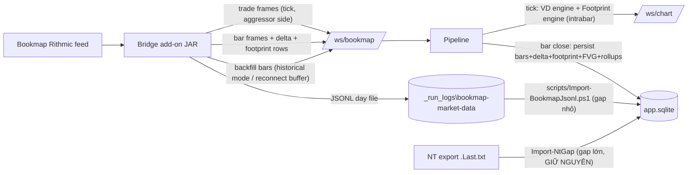

# Chuyển Volume Delta / Footprint sang nguồn Bookmap (single-source)

## Bối cảnh & Mục tiêu

Hiện tại:

- OHLCV realtime đã ưu tiên Bookmap (`NTTOTV_MARKET_DATA_PREFERRED_SOURCE=bookmap`), NT là fallback qua arbitration trong `backend/app/pipeline.py`.
- Volume delta + footprint + FVG **chỉ** được ghi bởi NT native indicator qua `POST /api/nt/native-bar` (`backend/app/rest/nt_native.py`), mỗi phút một lần khi NT đóng bar.
- Pipeline chỉ chạy VD engine cho `source == "nt"` (`pipeline.py` dòng ~648); trade Bookmap không cập nhật delta/footprint.
- Bridge Bookmap (`bookmap-bridge/src/main/java/com/nttotv/bookmap/`) đã tính đủ buy/sell volume, delta, deltaHigh/Low và ladder bid/ask từng price trong `BookmapFootprintAccumulator`, nhưng frame `bar` gửi qua `/ws/bookmap` chỉ có OHLCV; ladder chỉ ra file JSONL.

Mục tiêu:

1. Delta + footprint chạy **live tick-by-tick** từ Bookmap trades (không chờ bar close); bar close chỉ reconcile số authoritative.
2. Bookmap là **nguồn duy nhất** cho OHLCV + delta + footprint + FVG khi được bật; NT native ngừng ghi các cache này để tránh 2 writer đè nhau.
3. Fill history khi drop:
   - Bookmap tự backfill tối đa ~48h (pre-subscription + server backfill) khi re-attach — bật xử lý historical mode trong bridge.
   - Bridge replay buffer bar đóng khi websocket reconnect (backend restart).
   - Import JSONL day-file cho gap khi backend down nhưng Bookmap vẫn chạy.
   - **Giữ nguyên `Import-NtGap` / NT export** cho gap lớn hơn 48h hoặc khi Bookmap không chạy (Bookmap không có API download history theo range tùy chọn).

## Kiến trúc luồng dữ liệu sau thay đổi

## Task List

### Task 1 — Bridge: gửi delta + footprint rows trong bar frame

File: `bookmap-bridge/src/main/java/com/nttotv/bookmap/BookmapMarketDataBridge.java`

- Trong `enqueueBar(...)`, serialize thêm các field đã có sẵn trên `Bar`: `buyVolume`, `sellVolume`, `delta`, `deltaHigh`, `deltaLow`, `openDelta=0`, `closeDelta=delta`, và mảng `rows: [{price, bid, ask}]` (tái dùng logic serialize của `toJson(...)`).
- Áp dụng cho cả bar đóng, snapshot khi reconnect, và bar đang mở (snapshot current) để backend có ladder ngay khi connect lại.
- Cập nhật `BookmapWebSocketSenderTest`/`BookmapFootprintAccumulatorTest` nếu cần schema mới.

### Task 2 — Bridge: replay buffer khi websocket reconnect

File: `BookmapMarketDataBridge.java` (+ accumulator nếu cần)

- Thay vì chỉ giữ `lastClosedSnapshot()` (1 bar), giữ rolling buffer các bar đóng gần nhất (mặc định ~180 phút, config `NTTOTV_BOOKMAP_REPLAY_MINUTES`).
- Trong `enqueueSnapshots()` (callback `onConnected`), replay toàn bộ buffer dạng `snapshot=true, closed=true` theo thứ tự thời gian, rồi gửi current bar. Backend upsert idempotent nên replay thừa vô hại.

### Task 3 — Bridge: bật historical mode để backfill ~48h khi re-attach

File: `BookmapMarketDataBridge.java`

- Xử lý trades trong historical mode (trước `onRealtimeStart`) thay vì bỏ qua: accumulator build bar đóng như bình thường, các bar này gửi với flag `backfill=true` (và không ghi JSONL trùng nếu đã có — chấp nhận ghi lại, import idempotent).
- Không gửi heartbeat/trade frame realtime trong historical mode — chỉ gửi bar frames `backfill=true`.
- Giữ semantics `partialStart` cho bar đầu tiên sau khi historical data bắt đầu giữa phút.
- Bỏ/đổi ý nghĩa `NTTOTV_BOOKMAP_MARKET_INCLUDE_HISTORICAL`: mặc định bật backfill bar, có flag tắt nếu cần shadow test.
- Lưu ý rủi ro đã biết: backfill 48h từ server Bookmap có thể không có MBO order-id → BigTrade chain không dựng lại cho phần backfill; delta/footprint vẫn đúng vì dựa trên `isBidAggressor`.

### Task 4 — Backend: helper persist orderflow dùng chung

Files: `backend/app/rest/nt_native.py` → tách sang module mới, ví dụ `backend/app/engines/orderflow_persist.py` (hoặc `backend/app/orderflow_ingest.py` theo pattern hiện có)

- Tách `_build_footprint_update`, `_persist_native_payload`, `_rebuild_native_rollups`, `_rollup_volume_delta`, FVG seed/persist thành hàm dùng chung nhận `(cache, registry, runtime.native_fvg, payload fields)`.
- `nt_native.py` gọi lại helper để không thay đổi hành vi NT hiện tại (giữ nguyên API `/api/nt/native-bar`).

### Task 5 — Backend: ingest bar Bookmap có delta + footprint

Files: `backend/app/pipeline.py` (`on_bookmap_bar`), `backend/app/ingest/bookmap_endpoint.py`

- Parse các field mới (`buyVolume`, `sellVolume`, `delta*`, `rows`, `backfill`) từ bar frame.
- Khi bar `closed=true` (kể cả snapshot/backfill) và Bookmap là nguồn active: gọi helper Task 4 để ghi VolumeDelta 1m + footprint bar/levels + rollup delta các TF cao + FVG grading, và enqueue `volume_delta_update` / `footprint_update` / `fvg_signal_update` ra `/ws/chart`.
- Frame `backfill=true` hoặc `snapshot=true`: chỉ upsert cache + broadcast, **không** cập nhật heartbeat/latency/bar_close_lags, **không** chạy alert (giữ guard `snapshot` hiện có, thêm `backfill`).
- Bar đang mở (closed=false) có rows: dùng để seed footprint intrabar sau reconnect.

### Task 6 — Backend: delta + footprint live tick-by-tick từ Bookmap trades

File: `backend/app/pipeline.py` (`_run_trade_engines`)

- Mở rộng VD engines chạy cho `source == "bookmap"`: dùng `trade.side` (aggressor có sẵn từ Bookmap) thay vì suy luận bid/ask snapshot. Cần source-scoped VD engines (dict theo source như `_source_bars`) để NT fallback không trộn state; chỉ emit/persist khi source đang active.
- Thêm FootprintEngine instance cho Bookmap (tick_size 0.1, TF 1m): mỗi trade cập nhật ladder intrabar và emit `footprint_update` (registry đã throttle). Khi nhận authoritative closed bar (Task 5), reconcile/overwrite state intrabar để tránh drift.
- Đảm bảo cumulative delta seed đúng từ cache khi khởi động/switch (theo pattern VD engine hiện có).

### Task 7 — Backend: single-source Bookmap, tắt NT writer

Files: `backend/app/config.py`, `backend/app/pipeline.py`, `backend/app/rest/nt_native.py`

- Thêm setting `market_data_single_source` (env `NTTOTV_MARKET_DATA_SINGLE_SOURCE=bookmap`, default rỗng = giữ hành vi cũ).
- Khi bật: `_evaluate_source_selection` không switch về NT (`bookmap_stale` → active=None thay vì NT), NT trade/bar vẫn được nhận để giữ warm nhưng không ghi chart cache.
- `/api/nt/native-bar`: khi single-source bookmap, trả `{"ok": true, "ignored": "bookmap_single_source"}` — không ghi bars/delta/footprint/FVG (tránh NT đè số Bookmap trên cùng row). Vẫn log để so sánh nếu cần.
- `market_data_status_message` phản ánh mode single-source để frontend status hiển thị đúng.
- Cập nhật `scripts/Run-BackendProcess.ps1` để set env mới khi triển khai (chỉ khi được yêu cầu bật production).

### Task 8 — Import JSONL cho gap khi backend down (Bookmap vẫn chạy)

Files mới: `backend/app/backfill/bookmap_jsonl.py`, `scripts/Import-BookmapJsonl.ps1`

- Parser đọc JSONL schema v2 (`_run_logs\bookmap-market-data\*-v2-YYYY-MM-DD.jsonl`), filter theo range `--from/--to`, skip `partialStart` bar đầu, upsert bars + volume delta + footprint bars/levels (contract `GC`), rebuild rollup delta qua helper Task 4.
- Idempotent: chạy lại không nhân đôi (upsert theo key symbol/contract/tf/time; footprint levels delete-then-insert như nt_native).
- **KHÔNG** thay thế `Import-NtGap`: gap > 48h hoặc Bookmap không chạy → vẫn dùng NT export như quy trình hiện tại (Bookmap không có API tải history theo range tùy chọn; chỉ có pre-subscription + backfill 48h + replay file .bmf local nếu ngày đó máy có ghi).

### Task 9 — Tests

Backend (`backend/tests/`):

- Unit: parse bar frame mới (delta/rows/backfill), VD + footprint engine cho bookmap trades (side-based), single-source arbitration (không fallback NT, nt_native bị ignore), rollup delta từ bar Bookmap.
- Integration: `/ws/bookmap` bar closed → cache có volume_delta + footprint_levels + FVG; backfill frames không trigger alert/heartbeat; JSONL importer round-trip.
- Property test theo convention tag `Feature: gc-chart-platform, Property {n}: ...` cho invariant: footprint ladder tick-by-tick sau khi reconcile bar đóng == ladder authoritative từ bar frame.

Bridge (`bookmap-bridge`): mở rộng `BookmapFootprintAccumulatorTest` (buffer replay, historical bars) + serializer test cho bar frame mới.

### Task 10 — Verification & Rollout

1. `cd backend` → `.venv\Scripts\python.exe -m pytest` (focused: pipeline wiring, market source arbitration, nt_native ingest, bookmap ingest mới).
2. Build bridge: `powershell -File scripts\Build-BookmapMarketDataBridge.ps1`, re-attach JAR trong Bookmap vào `GCQ6.COMEX@RITHMIC`.
3. Shadow check trước khi cắt NT: chạy song song 1 phiên, so sánh bằng `backend\.venv\Scripts\python.exe scripts\compare_bookmap_nt_footprint.py --jsonl ... --db backend\data\app.sqlite` — delta/footprint Bookmap khớp NT native trong tolerance.
4. Bật `NTTOTV_MARKET_DATA_SINGLE_SOURCE=bookmap`, restart backend qua `scripts\Restart-Backend.ps1`, xác nhận `/api/health`, `market_data_status` active=bookmap, footprint/delta cập nhật tick-by-tick trên `https://gcflowpy.xyz/`.
5. Drill fill-history: restart backend giữa phiên (kiểm buffer replay), re-attach add-on (kiểm backfill 48h), và chạy thử `Import-BookmapJsonl.ps1` trên 1 range.
6. Frontend không đổi schema message nên chỉ cần smoke; nếu có chỉnh status UI thì `npm run build` để cập nhật `frontend/dist`.

## Ràng buộc & Rủi ro

- Backfill 48h của Bookmap có thể thiếu MBO order-id → BigTrade không dựng lại cho phần backfill (chấp nhận).
- Bar đầu sau attach là `partialStart` → không ghi đè bar cache tốt hơn đã có (guard khi upsert backfill: bỏ qua partialStart như comparison script).
- Hai writer NT/Bookmap trên cùng row là nguồn sai số chính → Task 7 phải merge trước khi bật production.
- Repo đang có nhiều file modified chưa commit (pipeline, nt_native, orderflow...) — implement trên working tree hiện tại, không revert thay đổi đang có.
- Không đụng `backend/data/`, `export data/`, file MT5 root theo quy tắc repo.